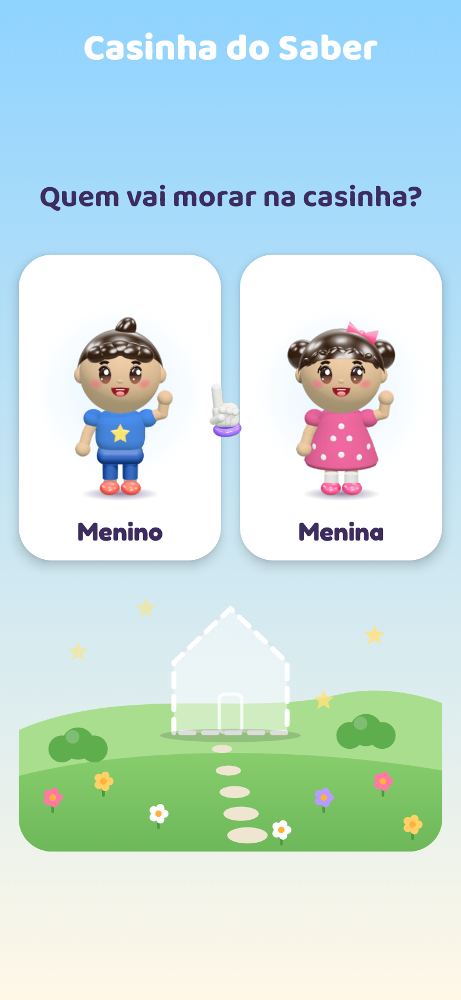
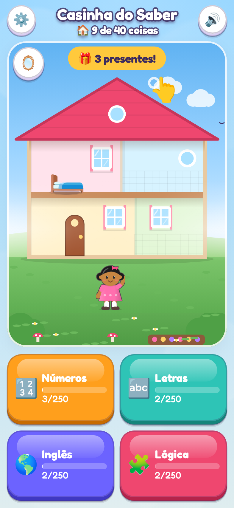
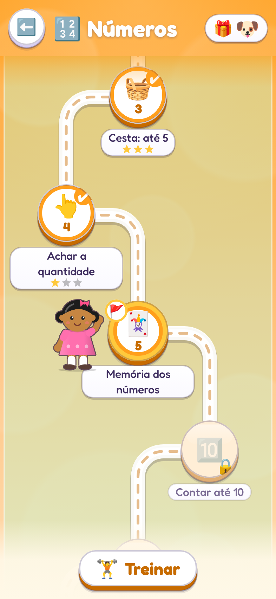
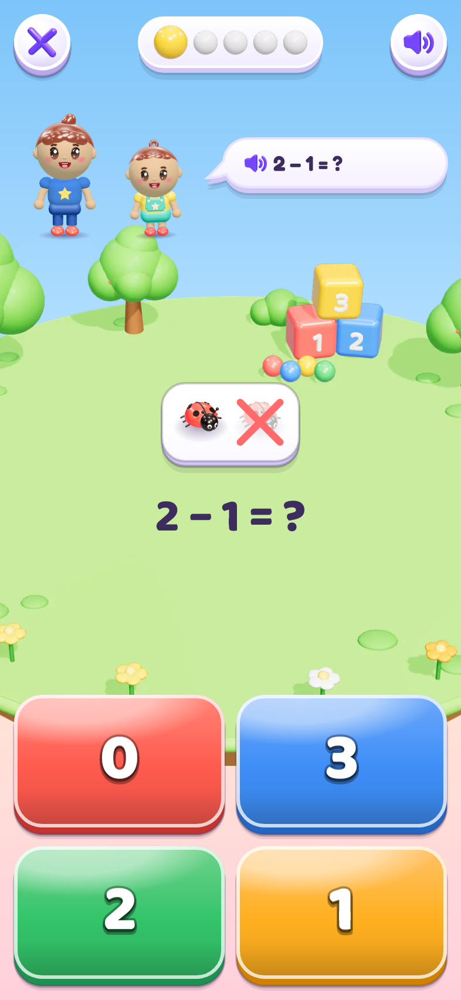
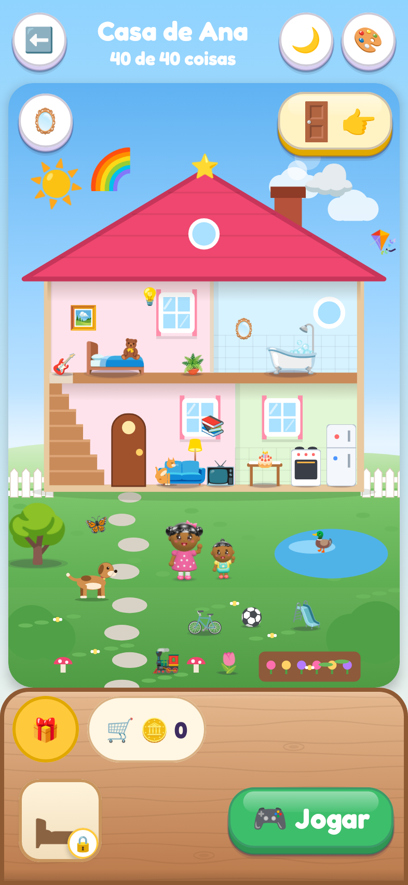

# Casinha do Saber 🏠

App Android educativo para crianças a partir de 4 anos. A criança escolhe ser um **menino ou uma menina**, joga nos quatro caminhos de aprendizado e, a cada fase nova vencida, ganha uma peça para **montar a sua casinha**: primeiro o terreno, as paredes, o telhado e a porta; depois a cama, o sofá, a geladeira, o cachorrinho, o laguinho com patinho e muito mais, até a estrela de campeão.

## Telas

| Escolha do personagem | Início | Caminho |
|---|---|---|
|  |  |  |

| Jogo | Prêmio | Casa completa |
|---|---|---|
|  |  |  |

As imagens de `docs/capturas/` são geradas automaticamente pelo CI a cada mudança (testes `CapturasTest`).

## Como funciona

**Quatro caminhos, dez fases cada, do mais fácil ao mais difícil:**

| Caminho | Fases |
|---|---|
| 🔢 Números | contar até 3, até 5, achar a quantidade, contar até 10, mais ou menos, somar até 5, tirar até 5, somar até 10, tirar até 10, desafio |
| 🔤 Letras | vogais A E I, todas as vogais, começa com vogal, outras letras, primeira letra, lendo palavras, sílabas, complete a palavra, rimas, desafio |
| 🌎 Inglês | colors, animals, numbers 1 a 5, fruits, more colors, my body, numbers 6 a 10, my house, toys, desafio |
| 🧩 Lógica | igual, diferente, grande e pequeno, filas de 2, o que combina, grupos, filas de 3, filas espertas, números em fila, desafio |

**Pensado para quem ainda não lê:**

* Toda pergunta é narrada em voz alta (voz do próprio Android, offline). As palavras em inglês usam a voz em inglês.
* Botões grandes, figuras grandes, respostas por toque.
* Errar não pune: a opção errada some, o narrador diz o que a criança tocou (por exemplo, "dog") e ela tenta de novo. As estrelas (1 a 3) mostram quantas tentativas foram.
* As perguntas são sorteadas a cada partida, então dá para repetir a fase sem decorar.

**A casinha é o coração do jogo:**

* Cada fase nova vencida vale um presente, que a criança abre tocando no 🎁.
* Os presentes vão para o **baú**. Tocar num presente coloca na casa: as estruturas "caem do céu" e se encaixam, os objetos aparecem no lugar certo.
* Os objetos podem ser **arrastados** para qualquer lugar. Levar um objeto para baixo da cena guarda de volta no baú.
* Com o 🎨, a criança toca num cômodo (quarto, banheiro, sala, cozinha) para trocar a cor da parede.
* Tocar num objeto fala o nome em português e em inglês. Tocar na criança faz ela pular e falar.
* A casa tem corte de "casa de bonecas", com dois andares, escada, chaminé com fumaça e jardim.

**Área dos pais** (botão ⚙️ com toque longo e uma continha de multiplicação): progresso por fase, ligar e desligar o som, trocar o personagem, apagar o progresso e dicas de uso.

**Privacidade:** sem internet, sem anúncios, sem coleta de dados. O progresso fica salvo só no aparelho.

## Como gerar o APK

### Pelo GitHub (sem instalar nada)

A cada push na pasta `casinha-do-saber/`, o workflow **Casinha do Saber (Android)** roda os testes e gera os APKs. Na aba **Actions** do repositório, abra a execução mais recente e baixe o artefato `casinha-do-saber-apk`. Copie o `.apk` para o celular e instale (é preciso permitir "instalar apps de fontes desconhecidas").

### No computador

Requisitos: Android Studio (Ladybug ou mais novo) ou JDK 17 com o Android SDK 35.

```
cd casinha-do-saber
./gradlew assembleDebug        # APK em app/build/outputs/apk/debug/
./gradlew testDebugUnitTest    # testes do conteúdo e do progresso
```

Ou abra a pasta `casinha-do-saber` no Android Studio e clique em Run.

### Publicar na Play Store

O build de release está assinado com a chave de debug só para facilitar testes. Para publicar, crie uma chave própria, configure `signingConfigs` em `app/build.gradle.kts` e gere um App Bundle (`./gradlew bundleRelease`). Apps para crianças precisam seguir a política **Famílias** do Google Play.

## Para a voz funcionar

O app usa o "Texto para fala" do Android. Na maioria dos celulares a voz em português do Brasil já vem instalada. Para ouvir o inglês com sotaque certo, instale também a voz em inglês em **Configurações > Sistema > Idiomas > Saída de texto para fala**.

## Organização do código

```
app/src/main/java/br/com/casinhadosaber/
  dominio/          Kotlin puro, testado: trilhas, gerador de perguntas, vocabulário,
                    itens da casa (ordem dos prêmios e posições), estado do jogo
  dados/            salva e carrega o progresso (SharedPreferences)
  audio/            Narrador (voz) e Sons (efeitos gerados na hora, sem arquivos)
  ui/componentes/   CenaDaCasa (desenho da casa e arrastar), Crianca (menino e menina),
                    botões, estrelas, confete
  ui/telas/         Perfil, Início, Caminho, Jogo, Prêmio, Casa, Área dos pais
```

* **Adicionar perguntas:** cada fase é um `Modelo` em `GeradorDeFases.kt`; o vocabulário fica em `Vocabulario.kt`.
* **Adicionar itens da casa:** `ItensDaCasa.ordem` define a ordem dos prêmios e onde cada objeto aparece (coordenadas de 0 a 1). O teste garante que existe um item para cada fase.
* **Desenhos:** a casa e as crianças são desenhadas em código (Canvas), então ficam nítidas em qualquer tela. Os objetos usam emojis da fonte Noto embutida no app (`emoji2-bundled`), iguais em todos os celulares.

## Créditos

* Fonte Fredoka, licença SIL Open Font License (`licencas/Fredoka-OFL.txt`).
* Emojis Noto Color Emoji (Google), licença SIL Open Font License, embutidos pela biblioteca AndroidX Emoji2.
