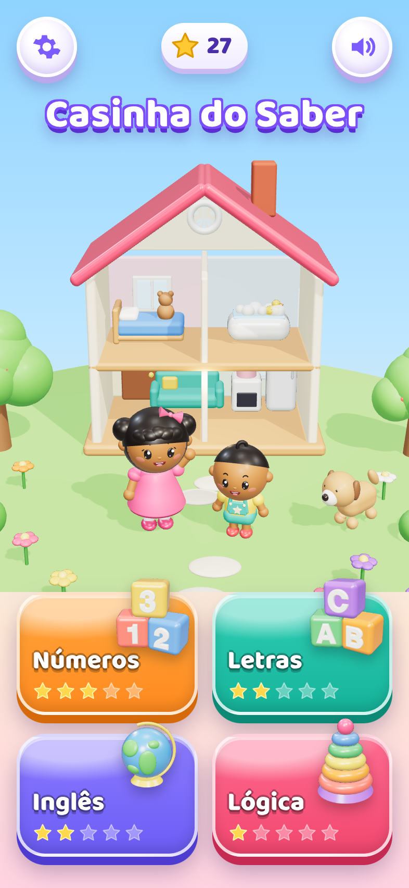
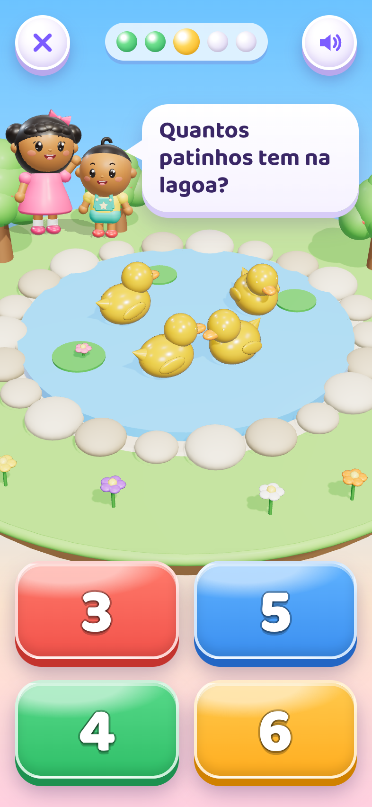
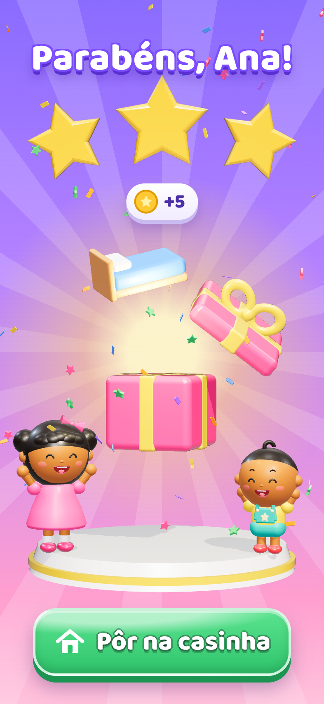

# Visual brinquedo 3D

Opção escolhida em 7 de novembro de 2026 entre as maquetes de visual novo (a opção 2, brinquedo 3D, contra a opção 3, aquarela).

* [PRD-visual-brinquedo-3d.md](PRD-visual-brinquedo-3d.md): plano de execução, fases e regras de delegação a subagentes.
* `maquetes/`: as três telas aprovadas (início, jogo e prêmio), referência obrigatória da arte.
* `prototipo/`: o código Three.js que gerou as maquetes, ponto de partida do pipeline de arte (como rodar na seção 4 do PRD).

| Início | Jogo | Prêmio |
|---|---|---|
|  |  |  |
