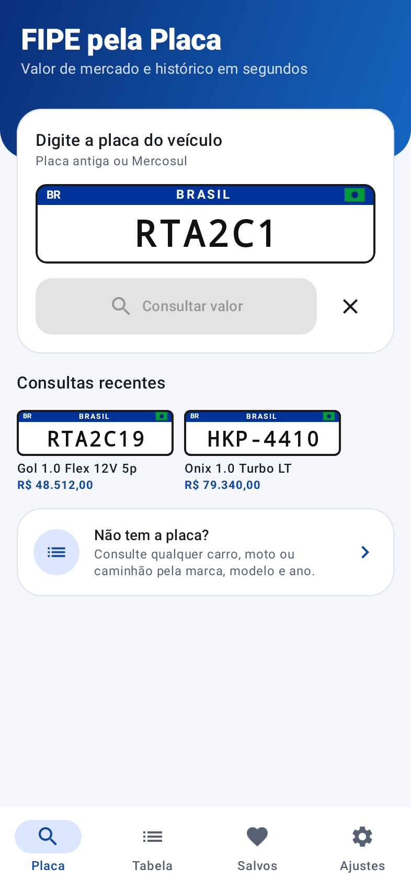
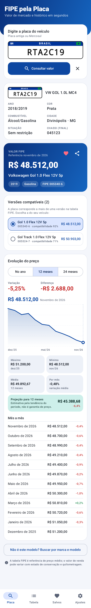
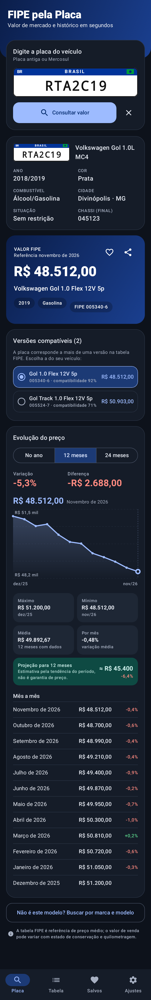
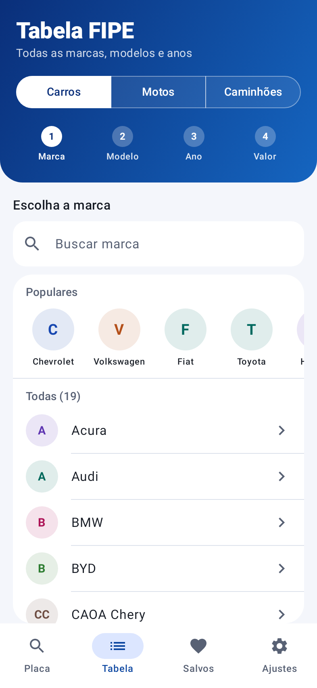
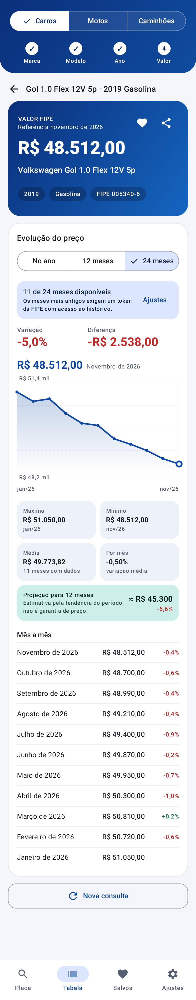
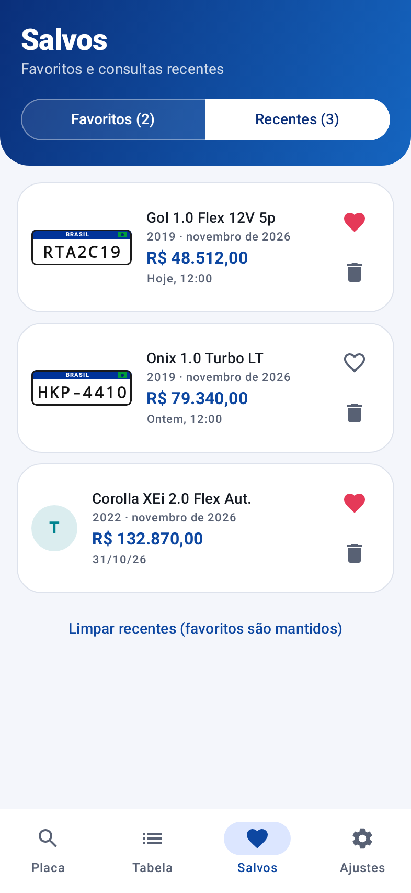
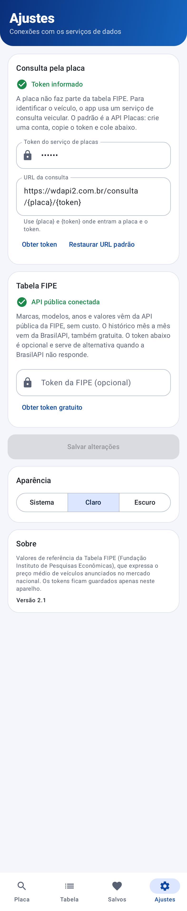
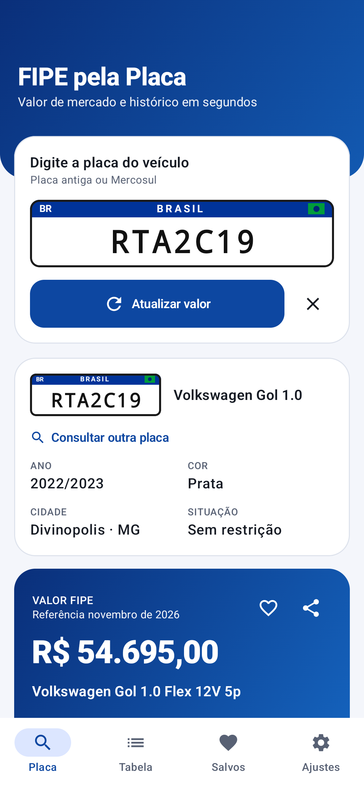
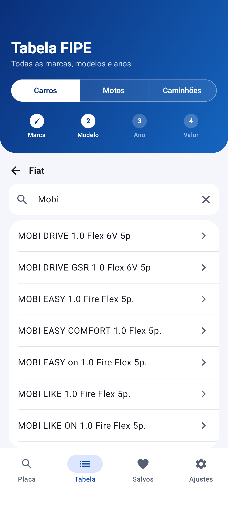
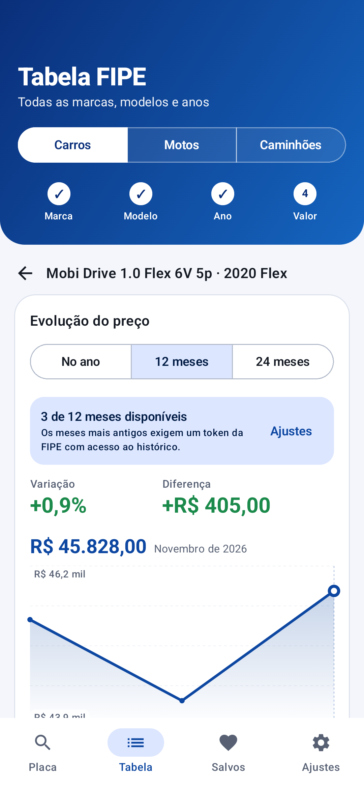

# FIPE pela Placa (Android)

Aplicativo Android (Kotlin + Jetpack Compose) que consulta o valor de mercado de veículos pela tabela FIPE.

## Telas

| Busca pela placa | Resultado | Modo escuro |
|---|---|---|
|  |  |  |

| Tabela FIPE | Valor e histórico | Salvos | Ajustes |
|---|---|---|---|
|  |  |  |  |

As capturas são geradas automaticamente pelo CI a cada alteração (Robolectric + Roborazzi), então sempre mostram a versão atual.

## Funcionalidades

1. **Busca pela placa**: campo no formato de placa Mercosul, aceita placa antiga (`ABC1234`) e Mercosul (`ABC1D23`). Mostra marca, modelo, ano, cor, cidade e situação, encontra o código FIPE e o valor de mercado. Quando a placa corresponde a mais de uma versão na FIPE, todas aparecem com o grau de compatibilidade para o usuário escolher.
2. **Tabela FIPE completa**: todas as marcas, modelos e anos de carros, motos e caminhões, com busca por texto (vários termos, sem acento), marcas populares em destaque, indicador de etapas clicável e destaque para veículos zero km.
3. **Histórico do preço**: evolução no ano atual, em 12 ou em 24 meses, com gráfico interativo (toque ou arraste para ver cada mês), variação percentual, diferença em reais, máximo, mínimo, média, variação mensal média, tabela mês a mês e projeção para 12 meses pela tendência.
4. **Salvos**: favoritos e consultas recentes guardados no aparelho. Reabrir uma placa salva não gasta crédito do serviço de placas.
5. **Compartilhar e copiar**: envia o resultado (com a variação do período) por WhatsApp, e-mail etc.; toque no código FIPE para copiar.
6. **Histórico local**: cada valor FIPE obtido para um veículo salvo fica guardado por mês no aparelho. O gráfico dos salvos cresce com o tempo, funciona sem internet e não depende de token.
7. **Acabamento**: tema claro e escuro (ou do sistema), tela de abertura, animações, esqueleto de carregamento, mensagens de erro claras, retorno tátil no gráfico e descrições de acessibilidade.

## Qualidade

1. Testes de unidade: validação de placa, formatos, leitor da resposta de placa, estatísticas, projeção, datas e regras dos salvos.
2. Testes de integração com servidor HTTP simulado (MockWebServer): busca manual completa, placa até o valor FIPE, histórico ignorando meses ausentes, uso do token e mensagens de erro (401, 429, sem conexão).
3. Testes de captura de tela de todas as telas, em tema claro e escuro.
4. Teste contra as APIs reais da FIPE no CI, com relatório em `docs/verificacao-api-real.txt`.
5. Testes de ponta a ponta num emulador Android 14 no CI, com internet real: busca por marca, modelo e ano até o histórico, e busca pela placa (provedor de placas simulado no aparelho, valor FIPE real) até favoritar e conferir em Salvos. Capturas do aparelho e relatório em `docs/emulador/`.
6. CI no GitHub Actions: roda tudo isso, publica as capturas e gera os APKs debug e release (com R8).

| No emulador: placa | No emulador: modelos | No emulador: histórico real |
|---|---|---|
|  |  |  |

## De onde vêm os dados

| Dado | Fonte | Token |
|---|---|---|
| Marcas, modelos, anos e valor atual | API FIPE pública v1 (`parallelum.com.br/fipe/api/v1`) | Não precisa |
| Histórico mês a mês | BrasilAPI (`brasilapi.com.br/api/fipe`) | Não precisa |
| Valor por código FIPE e alternativa do histórico | API FIPE v2 (`fipe.parallelum.com.br/api/v2`) | Opcional (sem token, meses antigos respondem 402) |
| Placa para marca, modelo e código FIPE | API Placas (`apiplacas.com.br`), configurável | Obrigatório |

A placa não faz parte da tabela FIPE: a ligação placa e veículo só existe em bases de consulta veicular, que são pagas. Por isso a busca pela placa exige o token de um desses serviços. O padrão é a API Placas (URL `https://wdapi2.com.br/consulta/{placa}/{token}`), mas em **Configurações** dá para trocar a URL por outro provedor com resposta parecida; o leitor da resposta aceita variações de nome dos campos.

Cada mês do histórico é uma consulta à BrasilAPI (com novas tentativas automáticas em caso de limite ou falha de rede). Se um mês não responder, o app tenta a API v2. Os resultados ficam em cache enquanto o app está aberto. A verificação contra as APIs reais roda no CI e grava o resultado em `docs/verificacao-api-real.txt`.

## Como obter o APK

O workflow `.github/workflows/fipe-android.yml` compila o app a cada push que altera `fipe-app/`. Abra a aba **Actions** do repositório, entre na execução mais recente de "App Android FIPE" e baixe o artefato `fipe-pela-placa-apk`. Instale o `app-release.apk` no celular (é preciso permitir instalação de fontes desconhecidas).

Os tokens nunca são embutidos no APK (poderiam ser extraídos dele): o usuário informa os seus na tela Ajustes. Eles ficam só no aparelho e não entram em backup.

## Compilar localmente

Requisitos: Android Studio (ou JDK 17 e Android SDK 35).

```bash
cd fipe-app
./gradlew assembleDebug        # gera app/build/outputs/apk/debug/app-debug.apk
./gradlew testDebugUnitTest    # testes unitários
```


## Estrutura

```
app/src/main/java/br/com/fipeplaca/
  data/   APIs (Retrofit), modelos, leitor da resposta de placa, repositório, formatos
  ui/     telas em Compose (Placa, Marca e modelo, Configurações), ViewModels, gráfico
```
